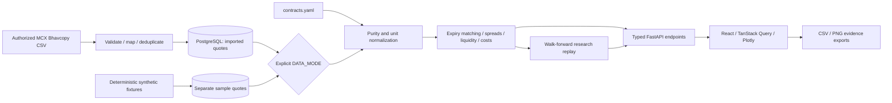

# CommodityLens

**See the gold market clearly.** An auditable MCX gold relative-value research platform with a React dashboard, FastAPI analytics service and PostgreSQL deployment configuration.

The default dataset contains **13,144 deterministic synthetic observations**, generated locally for 3 March 2025–9 October 2026. They are labeled **Sample data** throughout the interface. No market returns, customers, testimonials or funding claims are invented.

## Quick start — local development

Requires Python 3.14 and Node.js 24. From this directory:

```powershell
python -m venv .venv
.\.venv\Scripts\python.exe -m pip install -r api\requirements.lock
cd api
..\.venv\Scripts\python.exe -m uvicorn app.main:app --host 127.0.0.1 --port 8000
```

In a second terminal:

```powershell
cd web
npm ci
npm run dev
```

Open [the website](http://127.0.0.1:5173), [the dashboard](http://127.0.0.1:5173/app/overview), or [API documentation](http://127.0.0.1:8000/api/docs). SQLite is the local-development default. The sample dataset seeds once at API startup. On Linux/macOS, use `.venv/bin/python` in place of the Windows executable.

## Container deployment

```sh
python scripts/init_env.py
docker compose config --quiet
docker compose up --build --wait
```

Open [the packaged app](http://127.0.0.1:8080). `init_env.py` generates independent random database and operator secrets, refuses to overwrite an existing `.env`, and never prints secret values. `.env` is ignored by Git. The web listener binds to loopback deliberately: put a managed HTTPS reverse proxy and your required access controls in front of it before internet exposure. The database and API have no public host ports.

The three services include health checks, resource limits, bounded logs, restart policies, persistent PostgreSQL storage, non-root application processes, read-only application filesystems and request limits. Read [the deployment runbook](docs/DEPLOYMENT.md) before release. **Docker/PostgreSQL container execution was not verified on the development machine because Docker was unavailable.** CI includes that check, but a checked-in workflow is not evidence it has run.

## Architecture



```text
api/
  app/config.py          validated contract configuration and environment
  app/db.py              SQLAlchemy models, source isolation, atomic upserts
  app/ingestion.py       UDiFF / legacy CSV parsing and validation
  app/sample.py          reproducible synthetic seed, fixed RNG seed
  app/analytics.py       normalization, liquidity, carry, z-score and signals
  app/backtest.py        no-look-ahead research replay and block bootstrap
  app/models.py          explicit request and response schemas
  app/main.py            API routes, bounded compute, authenticated imports
  contracts.yaml        externally configured specification defaults
  tests/                 financial invariants and API/import tests
web/
  src/components/       reusable UI, themed charts and methodology panels
  src/App.tsx            routes, workspace, filters and command palette
  src/views.tsx          eight analytical / operational views
  src/Landing.tsx        marketing page with API-computed preview
  src/styles.css        obsidian / light tokens and responsive design
  tests/                 browser and automated accessibility checks
docs/                    methodology, sources, deployment and acceptance
compose.yaml             web / API / PostgreSQL deployment
```

## Delivered experience

- Landing page with computed preview, ticker, nine-step pipeline, six feature cards, comparison, planned pricing, roadmap and disclaimer.
- Overview, auditable Normalizer, Relative Value, Term Structure, Backtest Lab, Cost & Liquidity, Contract Explorer and Settings.
- Responsive dark/light interface, self-hosted fonts, reduced-motion support, command palette, tooltips, loading/error/empty states, toasts, chart CSV/PNG exports and URL filters.
- Same-month comparison; explicit constant-maturity interpolation where observations bracket the target. Interpolated and cross-location comparisons cannot become qualified signals or backtest trades.
- Prior-data z-scores and percentiles, cost/liquidity qualification, honest quiet states and explicit BLOCKED verdicts when a deviation exists but another gate fails.
- Next-session modeled entries, frozen walk-forward test blocks, gross/net equity, daily drawdown, monthly changes, trade ledger, turnover and conditional block-bootstrap intervals.
- Operator-authenticated, atomic CSV imports; SHA-256 repeat detection; sample/imported separation; typed API and OpenAPI documentation.

Roadmap items are **not implemented services**: mobile delivery, ML anomaly detection, team identity, enterprise connectors, commercial billing, additional commodities and global venues. They are deliberately shown as planned rather than nonfunctional controls. The current release is a single-workspace research application, not a brokerage or live execution system.

## API

| Endpoint | Behavior |
| --- | --- |
| `GET /api/contracts` | Configuration, units, purity, delivery basis and verification flag |
| `GET /api/normalized?date=&contracts=&month=` | Raw and normalized observations; comma-separated symbols |
| `GET /api/signals?date=&month=&window=&threshold=` | Ranked scores, qualification and explicit blocking reasons |
| `GET /api/spreads?pair=&from=&to=&month=&window=` | Pair spread, prior mean/std/z and interpolation flag |
| `GET /api/term-structure?contract=&date=` | Observed expiry curve and prior-date decomposition |
| `POST /api/backtest` | Validated parameters, metrics, equity, trades and assumptions |
| `GET /api/liquidity?contract=&date=&month=` | Up to 120 observations, grades and slippage assumptions |
| `GET /api/health` | Database reachability, source, dates, row count and freshness |
| `POST /api/ingest` | Multipart CSV, max 10 MB, `Authorization: Bearer <INGEST_TOKEN>` |

## Switch to real observations

1. Obtain an authorized public MCX Bhavcopy CSV. This application does not scrape undocumented endpoints or claim a live feed.
2. Configure `INGEST_TOKEN` in the API environment. Imports are disabled without it. In Compose it comes from `.env`; local development does not automatically load the root `.env`.
3. Upload via Settings or `/api/ingest`. The importer accepts UDiFF headers or documented aliases and rejects the entire supported subset if a row is invalid. Missing opens remain missing; close is never used as settlement.
4. Set `DATA_MODE=imported` and recreate the API: `docker compose up -d --force-recreate api`. This selects only imported rows. It never silently falls back to sample records.
5. Verify specification applicability to every expiry, source units, location economics and costs. Set `verified: true` in `api/contracts.yaml` only after doing so, then rebuild/restart the API. Imported-data signals and backtests are blocked until relevant specs are verified.

See [official source notes](docs/SOURCES.md), [methodology](docs/METHODOLOGY.md) and [release acceptance](docs/ACCEPTANCE.md). Files from the exchange have not been accepted against this deployment yet; parser support is tested with controlled format fixtures.

## Verification

```powershell
cd api
..\.venv\Scripts\python.exe -m pytest -q
cd ..\web
npm ci
npm run build
npm run test:e2e
```

Browser tests use locally installed Chrome on Windows and Playwright Chromium in Linux CI. On Linux, run `npx playwright install --with-deps chromium` first. To test built assets with production-equivalent CSP, set `PRODUCTION_PREVIEW=1` before the browser tests. Development servers are started/reused by the test configuration; test-created servers stop after completion.

Tests cover calculation invariants, future-price mutation/truncation, next-session entries, missing opens, thin markets, cost accounting, invalid input, source isolation, import idempotency, navigation, exports, themes, shared filters, mobile overflow, error recovery and automated WCAG A/AA checks on key views. Automated accessibility checks do not replace a manual screen-reader audit.

## Limits that matter

This is **research software**, not investment advice. Bhavcopy is end-of-day data. Purity normalization does not eliminate delivery basis. Defaults are assumptions, not certified trading costs. Backtests use fractional equal-notional positions and modeled open fills; they omit whole-lot hedging, queue position, actual bid/ask depth, margin, funding and physical delivery. A profitable simulated result does not prove an executable edge.

Read [methodology and limitations](docs/METHODOLOGY.md) before interpreting results. No software can warrant “no room for mistake”; deployment acceptance requires the real environment and representative authorized data.
# Commotidy_lens

